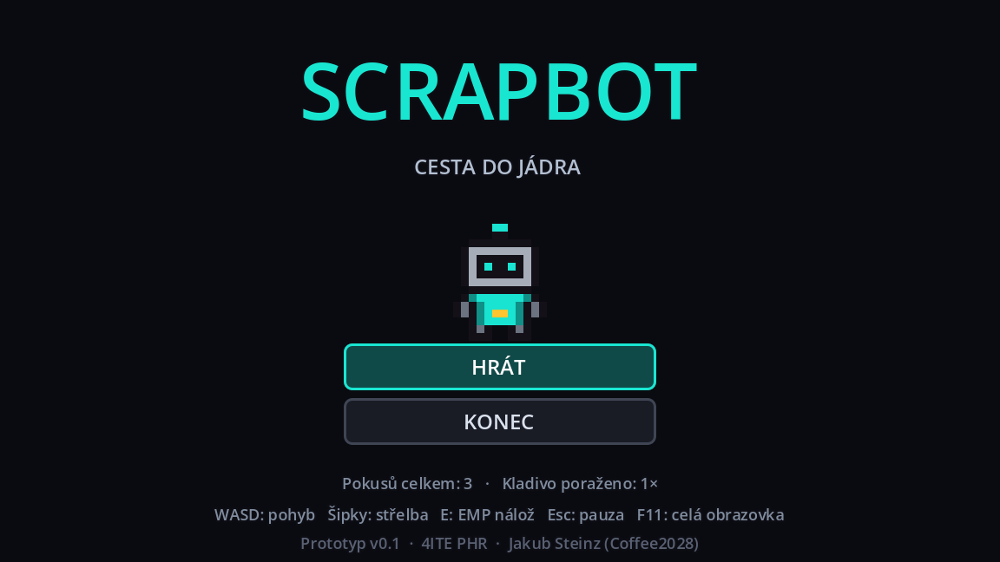
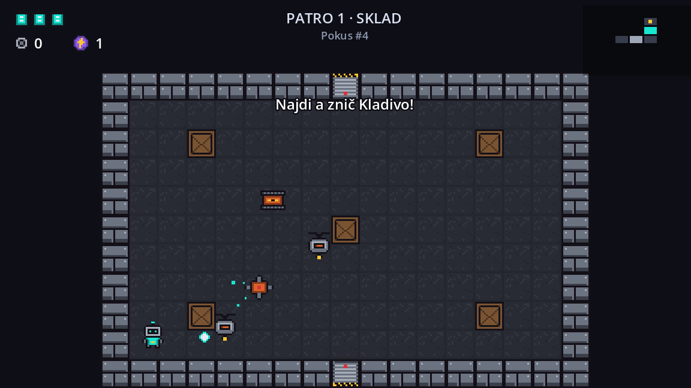
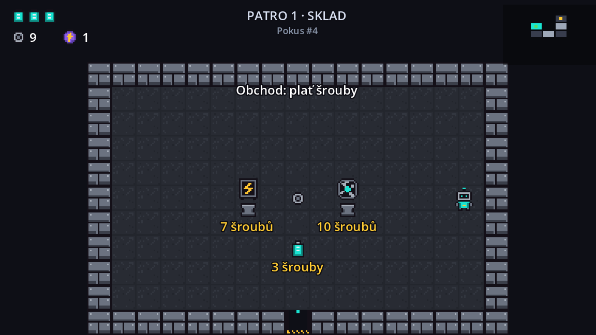
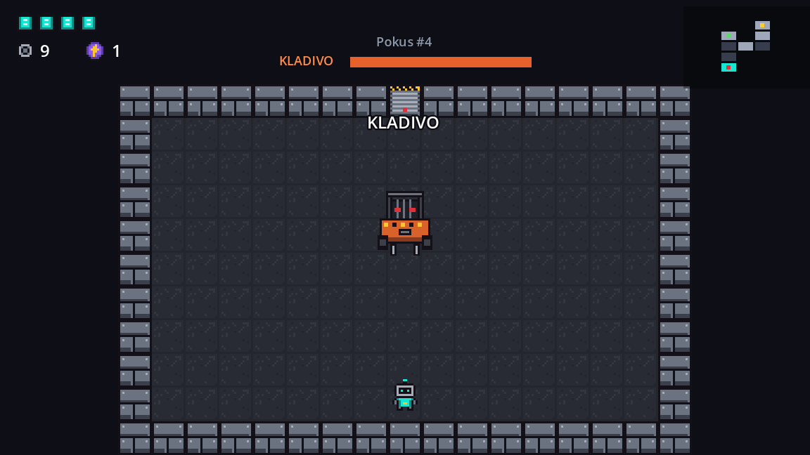

# 04 – Hra

[← Zpět na hlavní stránku](../README.md)

Hratelný prototyp SCRAPBOTu v Godotu 4. Obsahuje jedno náhodně generované patro („Sklad“) s bossem jménem Kladivo.

| | |
|---|---|
| **Verze** | 0.1.0 (prototyp) |
| **Engine** | Godot 4.7.2 (Standard), GDScript, renderer Compatibility |
| **Rozlišení** | 384 × 216 px (pixel art), okno 1152 × 648, **F11** = celá obrazovka |
| **Ovládání** | klávesnice nebo herní ovladač (Xbox / PlayStation) |



| | |
|---|---|
|  |  |
|  | |

## Jak hru spustit

1. Stáhni **Godot 4.7.2 – Standard** (ne .NET) z [godotengine.org](https://godotengine.org/download).
2. V Project Manageru klikni na **Import** a vyber soubor `04-hra/project.godot`.
3. Otevři projekt a stiskni **F5** (nebo ▶ vpravo nahoře).

Při prvním otevření Godot chvíli importuje obrázky a zvuky. Vytvoří si přitom skrytou složku `.godot/`, která se do gitu nenahrává (je v `.gitignore`).

### Export pro Windows (.exe)

1. **Project → Export… → Add… → Windows Desktop.**
2. Godot si napoprvé řekne o exportní šablony: **Manage Export Templates → Download and Install**.
3. **Export Project** a soubor ulož do složky `04-hra/export/` (ta je v `.gitignore`).
4. Hotový `.exe` se nahraje na stránku **Releases** repozitáře.

## Ovládání

| Akce | Klávesnice | Ovladač |
|---|---|---|
| Pohyb | W A S D | levá páčka nebo D-pad |
| Střelba (4 směry) | šipky | pravá páčka nebo Y / A / X / B |
| EMP nálož | E nebo Shift | LB / RB nebo spouště |
| Pauza | Esc nebo P | Start |
| Menu | šipky + Enter, myš | D-pad / levá páčka + A |
| Celá obrazovka | F11 | – |

Nápověda v horní liště se sama přepne podle toho, čím hráč zrovna hraje (klávesnice / ovladač).

## Co prototyp obsahuje

- **Patro z 10 místností**, při každém pokusu jiné: start, běžné místnosti, pokladová místnost, obchod a místnost s bossem.
- **Zavřené dveře** – dokud robot nezničí všechny nepřátele v místnosti, nedostane se ven. U otevřených dveří robota jemně navede do středu průchodu, aby se nezasekl o roh zdi.
- **3 druhy nepřátel a boss:**

| Nepřítel | Životy | Chování |
|---|---|---|
| Dron | 3 | pomalu letí k robotovi a kličkuje, zraní dotykem |
| Vozík | 4 | jezdí sem a tam; když je s robotem v jedné řadě, zabliká a vyrazí |
| Věžička | 5 | stojí na místě a střílí do čtyř stran, směr se postupně pootáčí |
| **Kladivo** (boss) | 45 | vysokozdvižný vozík: najíždí na robota, po nárazu do zdi rozhází kruh střel, mezi nájezdy střílí vějíře; pod polovinou života se rozzuří a zrychlí |

- **Věci na zemi:** článek baterie (+1 život), šroub (peníze), EMP nálož.
- **Bedny:** robot je rozstřílí (dva obyčejné zásahy, po prvním praskne) nebo rozbije EMP nálož. Občas z nich vypadne šroub. Střely nepřátel se o bedny jen zastaví, takže slouží jako kryt.
- **EMP nálož:** po chvíli vybuchne, zraní nepřátele v okolí a rozbije bedny v dosahu.
- **5 předmětů** (vylepšení robota):

| Předmět | Účinek |
|---|---|
| Turbo ventilátor | rychlejší střelba |
| Magnetická cívka | střely se stáčejí k nepřátelům |
| Přetaktovaný čip | větší poškození, ale robot je pomalejší |
| Záložní baterie | jeden článek baterie navíc (a doplní všechny) |
| Zaseknuté relé | každý výstřel je jiný (rychlost, velikost, poškození) |

- **Pokladová místnost:** jeden předmět zdarma. **Obchod:** dva předměty za 7 a 10 šroubů a článek baterie za 3 šrouby.
- **HUD:** články baterie (životy), šrouby, EMP nálože, minimapa, číslo pokusu a ukazatel života bosse.
- **Menu:** hlavní menu, pauza, obrazovka prohry („Robot zničen“) a výhry („Patro 1 vyčištěno“).
- **Statistiky** pro ověření hypotéz (viz níže).

## Jak to funguje

### Uzly a skripty

Godot skládá hru z **uzlů** (nodes) – robot, zeď, střela i nápis jsou uzly. Projekt má jen jednu scénu `scenes/main.tscn` s jedním uzlem `Game`. Všechno ostatní (místnosti, robota, nepřátele, menu) si skripty vytvoří samy v kódu pomocí `.new()` a `add_child()`. Celé chování hry je tak vidět v kódu a nic není schované v editoru.

### Autoloady

`Controls`, `Stats` a `Sfx` jsou **autoloady** – skripty, které běží celou dobu a dají se zavolat odkudkoli svým jménem, například `Sfx.play("shoot")` nebo `Stats.end_run("smrt")`.

### Signály

Uzel ohlásí, že se něco stalo (**signál**), a jiný uzel na to zareaguje. Příklad: nepřítel při zničení vyšle signál `died` → místnost odečte počet živých nepřátel → když je nula, otevře dveře a vyšle signál `cleared`.

### Dědičnost nepřátel

Všichni nepřátelé dědí ze společného skriptu `enemy.gd` (`extends Enemy`). Ten umí životy, zásah, odhození, blikání po objevení a výstřel. Každý druh nepřítele si pak doplní jen svou funkci `think()`, tedy co má dělat každý snímek.

### Fyzikální vrstvy

Každá věc patří do jedné vrstvy a „vidí“ jen některé další vrstvy. Díky tomu střela robota nezraní robota a střela nepřítele nezraní nepřítele.

| Vrstva | Co v ní je | Narazí do |
|---|---|---|
| 1 `steny` | zdi, bedny, zavřené dveře | – |
| 2 `robot` | robot | zdi |
| 3 `nepratele` | nepřátelé a boss | zdi |
| 4 `strely_robota` | střely robota | zdi, nepřátelé |
| 5 `strely_nepratel` | střely nepřátel | zdi, robot |
| 6 `predmety` | věci na zemi, předměty | robot |

### Generování patra (`floor_gen.gd`)

1. Začne startovní místností uprostřed mřížky 7 × 7.
2. Náhodně přidává sousední místnosti, dokud jich není 10. Nová místnost smí sousedit jen s jednou existující, takže nevzniknou kruhy ani shluky.
3. Najde slepé uličky (místnosti s jedněmi dveřmi). Nejvzdálenější od startu (aspoň 3 místnosti daleko) dostane bosse, další dvě se stanou pokladovou místností a obchodem.
4. Do běžných místností rozmístí bedny a 2–5 nepřátel – čím dál od startu, tím víc. Nepřátelé se nikdy neobjeví hned u dveří.

Patro je zatím jen slovník (`Dictionary`) s daty. Skutečná místnost se postaví (`room.gd`) až ve chvíli, kdy do ní robot vejde. Co se v ní změní (vyčištění, sebrané věci, rozbité bedny), se zapíše zpátky do dat, takže po návratu vypadá stejně.

### Průběh hry (`game.gd`)

Hra má čtyři stavy: **TITLE** (hlavní menu) → **PLAYING** (hraje se) ⇄ **PAUSED** (pauza) → **OVER** (prohra nebo výhra). Při průchodu dveřmi obrazovka krátce ztmavne, stará místnost zmizí, postaví se nová a robot se objeví u protějších dveří.

## Struktura složky

```
04-hra/
├── project.godot            nastavení projektu (rozlišení, autoloady, fyzikální vrstvy)
├── icon.png                 ikona hry
├── scenes/
│   └── main.tscn            jediná scéna – uzel Game se skriptem game.gd
├── scripts/
│   ├── game.gd              řízení hry: menu → hra → pauza → konec, přechody mezi místnostmi
│   ├── floor_gen.gd         generátor patra
│   ├── room.gd              jedna místnost: podlaha, zdi, dveře, bedny, nepřátelé, odměny
│   ├── player.gd            robot: pohyb, střelba, životy, účinky předmětů
│   ├── bullet.gd            střela robota i nepřátel (včetně samonavádění)
│   ├── emp.gd               EMP nálož
│   ├── crate.gd             bedna (rozstřílení, prasklina)
│   ├── pickup.gd            věci na zemi (baterie, šroub, EMP)
│   ├── item_pedestal.gd     podstavec s předmětem
│   ├── items.gd             seznam předmětů (název, popis, ikona)
│   ├── hud.gd               horní lišta
│   ├── minimap.gd           minimapa
│   ├── menus.gd             hlavní menu, pauza, prohra, výhra
│   ├── fx.gd                efekty: jiskry, výbuchy, plovoucí text
│   ├── controls.gd          (autoload) ovládání – klávesnice a ovladač
│   ├── stats.gd             (autoload) statistiky pro hypotézy
│   ├── sfx.gd               (autoload) přehrávání zvuků
│   └── enemies/
│       ├── enemy.gd         společný základ všech nepřátel
│       ├── drone.gd         dron
│       ├── cart.gd          vozík
│       ├── turret.gd        věžička
│       └── boss_forklift.gd boss Kladivo
├── assets/
│   ├── sprites/             25 obrázků v pixel artu
│   └── sfx/                 13 zvukových efektů
└── screenshoty/             obrázky do tohoto README (Godot je ignoruje díky .gdignore)
```

Soubory `.import` a `.uid` vytváří Godot sám. Patří do gitu a nemají se mazat.

## Jak něco upravit

| Co chci změnit | Kde |
|---|---|
| životy a rychlost nepřátel | `scripts/enemies/*.gd` (`hp`, `SPEED` …) |
| počet nepřátel v místnosti | `floor_gen.gd` → `_fill_normal()` |
| počet místností | `floor_gen.gd` → `ROOM_COUNT` |
| životy, rychlost a střelba robota | `player.gd` → `max_cells`, `speed`, `fire_delay`, `damage` |
| ceny v obchodě | `floor_gen.gd` → `_place_items()` |
| výdrž beden | `crate.gd` → `MAX_HP` |
| šance na šroub z bedny | `room.gd` → `break_crate()` |
| nový předmět | záznam v `items.gd` + účinek v `player.gd` → `apply_item()` + ikona v `assets/sprites/` |

## Statistiky a hypotézy

Hra sama zapisuje data, která jsou potřeba k ověření [hypotéz z ideového plánu](../01-ideovy-plan/README.md#6-hypotézy).

**Kde data najdu:** `%APPDATA%\SCRAPBOT\` (složku otevře i tlačítko **Složka se statistikami** v pauze).

- `pokusy.csv` – jeden řádek = jeden pokus. Dá se otevřít v Excelu (oddělovač je středník).
- `stats.cfg` – souhrn: počet všech pokusů, počet výher a pokus, ve kterém byl boss poražen poprvé.

| Sloupec v `pokusy.csv` | Význam |
|---|---|
| `datum` | kdy pokus skončil |
| `pokus` | pořadí pokusu na tomto počítači |
| `pokus_od_spusteni` | pořadí pokusu od posledního spuštění hry |
| `vysledek` | `vyhra`, `smrt` nebo `vzdal` (nový pokus / odchod do menu / zavření okna) |
| `vycistene_mistnosti` | kolik místností hráč vyčistil |
| `dosel_k_bossovi` | jestli hráč došel až k bossovi |
| `cas_s` | délka pokusu v sekundách |
| `predmety` | sebrané předměty |

- **Hypotéza 1** (aspoň 3 pokusy za jedno hraní): nejvyšší hodnota `pokus_od_spusteni` při každém hraní.
- **Hypotéza 2** (boss poražený nejpozději ve 3. pokusu): hodnota `pokus` u prvního řádku s výsledkem `vyhra`.

> **Tip pro testování:** sloupec `pokus` počítá všechny pokusy na daném počítači. Když se u jednoho počítače vystřídá víc testerů, je potřeba před každým novým testerem složku `%APPDATA%\SCRAPBOT\` přejmenovat (nebo ji uschovat jinam), aby počítání začínalo znovu od 1.

## Známá omezení prototypu

- Jen jedno patro. Po poražení Kladiva a vstupu do poklopu hra skončí obrazovkou výhry.
- Zatím bez hudby, jen zvukové efekty.
- Grafika a zvuky jsou prototypové, vygenerované skripty (viz [03 – Assety](../03-assety/README.md)).
